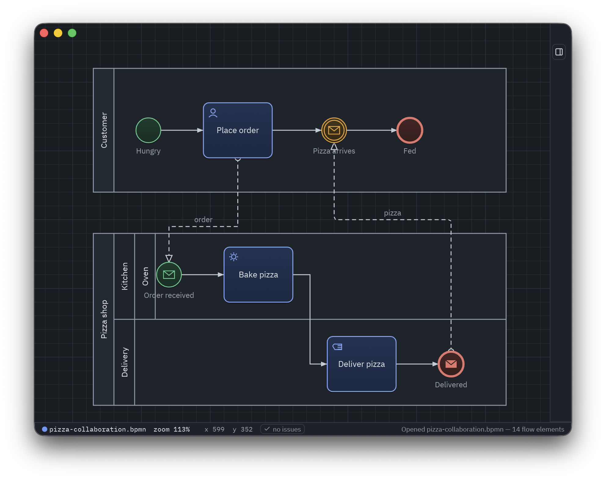

# boss

A truly open-source BPMN application.

boss is a BPMN 2.0 process designer written in Rust with [iced](https://iced.rs),
targeting desktop (macOS, Windows, Linux) and the web (WebAssembly) from a single
codebase. Files are standard BPMN 2.0 XML (ISO/IEC 19510) with diagram interchange,
interoperable with Camunda Modeler, bpmn.io, and friends. The running app also
exposes an [MCP](https://modelcontextprotocol.io) server so AI agents can build and
edit processes live on the canvas.



**Status:** feature-complete editor — events, tasks, gateways, subprocesses,
pools/lanes with message flows, data objects and annotations, live validation,
orthogonal routing, SVG export, and the live MCP server.

## Workspace

| Crate           | Purpose                                                      |
|-----------------|--------------------------------------------------------------|
| `bpmn-core`     | BPMN 2.0 semantic model + DI types (no UI/XML dependencies)  |
| `bpmn-xml`      | BPMN XML reader/writer with round-trip fidelity              |
| `bpmn-validate` | Validation rule engine                                       |
| `boss-mcp`      | MCP server for live agent control                            |
| `boss`          | The iced application (canvas editor, panels, platform glue)  |

## Development

```sh
# Desktop
cargo run -p boss

# Web (requires trunk: cargo install trunk)
trunk serve

# Checks
cargo fmt --all --check
cargo clippy --workspace --all-targets -- -D warnings
cargo test --workspace
```

## MCP

The desktop app can expose a [Model Context Protocol](https://modelcontextprotocol.io)
server so AI agents edit the open diagram live on your canvas (every change is
undoable). Start it with the toolbar button or `cargo run -p boss -- --mcp`,
then connect a client to `http://127.0.0.1:4555/`, e.g.:

```sh
claude mcp add --transport http boss http://127.0.0.1:4555/
```

The endpoint binds to localhost only. To require an access token, start with
`--mcp-token <secret>`; every request must then carry
`Authorization: Bearer <secret>`.

UI fonts (IBM Plex, OFL licensed) are embedded from `assets/fonts/`.

## License

[CC0 1.0](LICENSE) — public domain dedication. Font files in `assets/fonts/` are
licensed separately under the [SIL Open Font License](assets/fonts/OFL.txt).
